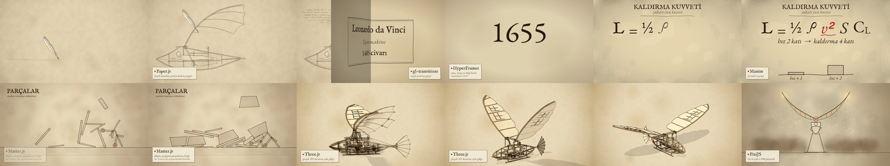

# Kalem

**Türkçe** | [English](README.en.md)

> Her sahnenin kendi kalemi var.

Yapay zekâya kodla video yaptırınca hepsi birbirine benziyor, çünkü bütün sahneleri tek bir motorla çiziyor. **Kalem**, Claude Code için yazılmış bir skill. Videoyu sahnelere böler, her sahnenin içinde ne olduğuna bakar ve onu en iyi çizen motoru seçer. Sonra sahneleri o motorlarla üretir, sayfa çevirme gibi geçişlerle birleştirir ve görüntüye kare kare oturan efekt sesini ekler.

Sen yalnızca ne istediğini anlatırsın. Hangi sahnenin hangi kalemle çizileceğine skill karar verir.



## Hangi sahne, hangi motor

| Sahnenin içinde... | Motor |
|---|---|
| Kendi kendine çizilen çizgi, eskiz | Paper.js |
| Karakter, yürüme, şeklin başka şekle dönüşmesi | Düz canvas |
| Patlama, ışık, toz, binlerce küçük parça | PixiJS |
| Yazı, sayı, sayaç, bilgi kartı | HyperFrames (HTML + GSAP) |
| Gerçek 3D: dönen kamera, ışık, gölge | Three.js |
| Formül, grafik, şema | Manim |

Yardımcılar: Matter.js ve Rapier (fizik), gl-transitions (125 geçiş, sayfa çevirme dahil), Tone.js (kareye kilitli efekt sesi), Anime.js, tsParticles, glTF-Transform.

Bu tablo bir kişinin zevkiyle kuruldu: 20 araç aynı sahneyle yarıştırıldı, izlenip puanlandı. Kendi denemelerini yap, tabloyu kendi gözüne göre değiştir. Tablo `.claude/skills/kalem/SKILL.md` içinde.

## Kurulum

Gerekenler: macOS ya da Linux, Node 20+, Python 3, ffmpeg, Google Chrome, [Claude Code](https://claude.com/claude-code). Manim isteğe bağlı.

```bash
git clone https://github.com/leodavincs/kalem.git
cd kalem
./kurulum.sh
```

Formül sahneleri için Manim: `python3 -m pip install manim` (ya da `MANIM_PY` ile başka bir python göster).

## Kullanım

Repo klasöründe Claude Code'u aç ve videonu anlat:

```
claude
/kalem Leonardo da Vinci'nin uçan makinesini anlatan 50 saniyelik yatay bir video yapalım...
```

Claude önce sahne tablosunu gösterir (hangi sahne, hangi motor, neden) ve onayını bekler. Sonra her sahneyi kendi klasöründe üretir, kontrol karelerine bakar ve birleştirir. Çıktı `projeler/<ad>/cikti.mp4`.

Elle birleştirmek istersen:

```bash
python3 birlestir.py projeler/<ad> --gecis BookFlip --etiket
```

`--etiket` her sahnenin köşesine o sahneyi hangi motorun çizdiğini yazan küçük bir kart basar.

## Örnek: uçan makine

`ornek/ucan-makine/` altında altı sahne var, her biri başka bir motorla çizildi: Paper.js, HyperFrames, Manim, Matter.js, Three.js, PixiJS. Sonuç `ornek/ucan-makine/onizleme.mp4`. Her sahnenin klasöründe kendi kodu, `calistir.sh` dosyası ve kontrol karesi duruyor. Ortak görsel dil `BRIEF.md` içinde.

## Nasıl çalışıyor

- Zaman kare numarasından gelir. Rastgele sayılar tohumlu, aynı komut her seferinde aynı kareyi verir.
- Tarayıcı motorları Chrome'da kare kare yakalanır (`ortak/yakala.py`), video gerçek zamanlı kaydedilmez. Ağır sahne de takılmadan çıkar.
- Her sahne `olaylar.json` yazar (çizgi başladı, bir şey düştü, kanat çırptı). Ses bu listeden üretilir, bu yüzden ses görüntüden hiç kaymaz.
- Sahneler birbirinden bağımsız, paralel üretilebilir.

## Lisans

MIT. `ortak/font/` içindeki yazı tipleri SIL Open Font License 1.1 ile dağıtılır.

Leo (leodavincs)
